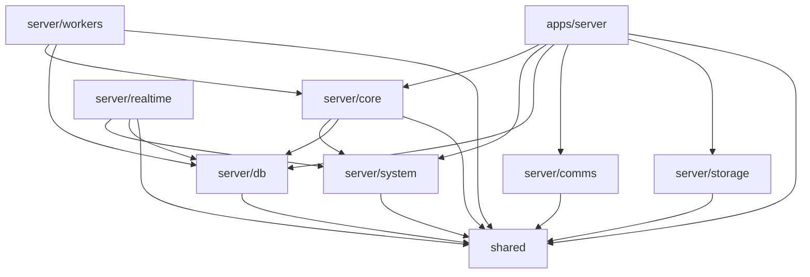

# Server Dependency DAG

Last verified: 2026-06-08 (against actual `package.json` declarations).

`apps/server` depends only on the minimal baseline at compile time. Baseline `comms` and `storage` adapters are workspace dependencies because auth email delivery and file/avatar storage are part of the starter runtime. Optional product capability packages (`realtime`, `workers`) are loaded dynamically at runtime when their feature flags are enabled.

## Package DAG (workspace dependencies)

## Package Matrix

| Layer             | Package               | Workspace deps                                                                                  |
| ----------------- | --------------------- | ----------------------------------------------------------------------------------------------- |
| `apps/server`     | `@bslt/server`        | `@bslt/core`, `@bslt/db`, `@bslt/server-system`, `@bslt/comms`, `@bslt/storage`, `@bslt/shared` |
| `server/core`     | `@bslt/core`          | `@bslt/server-system`, `@bslt/db`, `@bslt/shared`                                               |
| `server/system`   | `@bslt/server-system` | `@bslt/shared`                                                                                  |
| `server/db`       | `@bslt/db`            | `@bslt/shared`                                                                                  |
| `server/realtime` | `@bslt/realtime`      | `@bslt/db`, `@bslt/server-system`, `@bslt/shared`                                               |
| `server/comms`    | `@bslt/comms`         | `@bslt/shared`                                                                                  |
| `server/storage`  | `@bslt/storage`       | `@bslt/shared`                                                                                  |
| `server/workers`  | `@bslt/workers`       | `@bslt/core`, `@bslt/db`, `@bslt/shared`                                                        |
| `shared`          | `@bslt/shared`        | —                                                                                               |

## Guidance

- `apps/server` remains composition/integration shell.
- `server/core` remains business-domain package.
- `server/system` remains runtime/infrastructure package.
- Optional product packages (`realtime`, `workers`) must not become mandatory dependencies of minimal runtime layers.
- Baseline `comms` and `storage` remain adapter packages owned by the server composition shell; keep domain packages such as `server/core` free of direct adapter imports.
