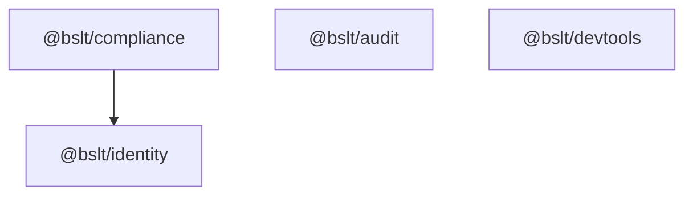

<!-- @generated by pnpm bslt sync docs from bslt.config.ts and main/modules/*/module.ts. Do not edit. -->

# Module Dependency Graph

Strict acyclic dependency graph across all vertical modules registered in `bslt.config.ts` (`module-graph` gate).

## Dependency DAG

## Module Inventory

| Package            | Scope       | Status   | `dependsOn` | Endpoints | Tables | Events | Jobs |
| ------------------ | ----------- | -------- | ----------- | --------- | ------ | ------ | ---- |
| `@bslt/identity`   | `installed` | `stable` | —           | 86        | 14     | 10     | 0    |
| `@bslt/compliance` | `installed` | `stable` | `identity`  | 17        | 7      | 7      | 1    |
| `@bslt/audit`      | `installed` | `stable` | —           | 6         | 2      | 0      | 1    |
| `@bslt/devtools`   | `devOnly`   | `stable` | —           | 1         | 0      | 0      | 0    |
